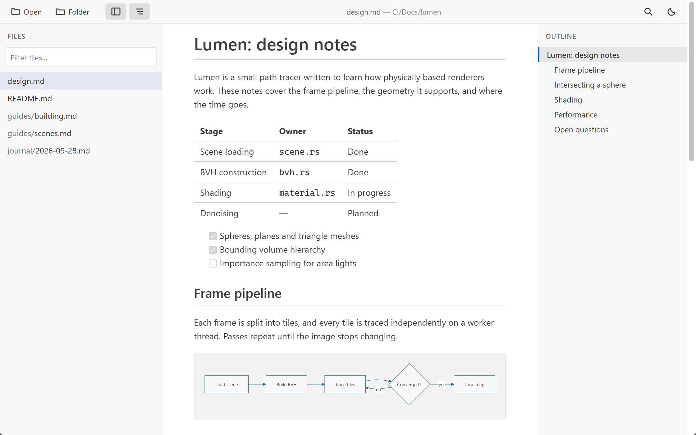
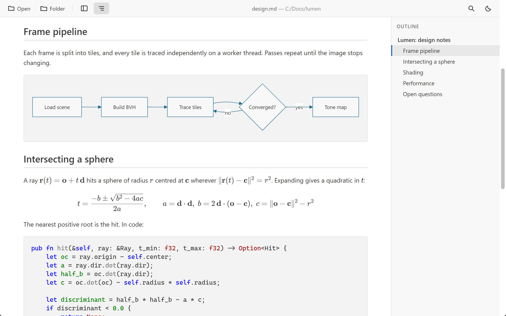

<h1 align="center">MarkReader</h1>

<p align="center">
  A fast, standalone desktop Markdown reader that renders exactly like VS Code's preview, with no editor required.
</p>

<p align="center">
  <a href="https://github.com/usamaiqb/markreader-desktop/releases/latest"></a>
  <a href="LICENSE"></a>
  
  
</p>

<p align="center">
  <picture>
    <source media="(prefers-color-scheme: dark)" srcset="metadata/screenshots/01-main-dark.png">
    
  </picture>
</p>

## Download

Grab the latest installer from the **[Releases page](https://github.com/usamaiqb/markreader-desktop/releases/latest)**.

| Platform | Format                  |
| -------- | ----------------------- |
| Windows  | `.exe` (NSIS installer) |
| Linux    | `.deb` and `.AppImage`  |

> **Windows note:** the installer is not yet code-signed, so SmartScreen may warn on first launch. Choose **More info → Run anyway**.

Once installed, double-clicking any `.md` or `.markdown` file opens it in MarkReader.

## Why MarkReader?

- **Faithful rendering:** CommonMark, GFM tables, syntax highlighting, KaTeX math and Mermaid diagrams, using the same stylesheets as VS Code's preview
- **Open from anywhere:** file picker, drag-and-drop, terminal, or double-click
- **Tabs** for every open document, with VS Code-style preview tabs while you browse, reopened where you left them on the next launch
- **Folder browsing** with a sidebar of your Markdown files
- **Live reload** that keeps your scroll position
- **Outline, find and themes** that follow your OS
- **Small and private:** a ~5MB executable, no telemetry, everything runs locally

## Screenshots

<p align="center">
  <picture>
    <source media="(prefers-color-scheme: dark)" srcset="metadata/screenshots/02-rendering-dark.png">
    
  </picture>
</p>

## Usage

| Action | How |
| --- | --- |
| Open files | `Ctrl+O`, **Open** button, or drag-and-drop — several at once each get a tab |
| Open a folder | `Ctrl+Shift+O`, or **Folder** button |
| Close / reopen a tab | `Ctrl+W` / `Ctrl+Shift+T` |
| Switch tabs | `Ctrl+Tab` (most recent), `Ctrl+PgDn` / `Ctrl+PgUp`, `Ctrl+1`…`Ctrl+9` |
| Keep a preview tab | Double-click it, or the file in the sidebar |
| Toggle sidebar | `Ctrl+B` |
| Toggle outline | `Ctrl+Shift+B` |
| Find in document | `Ctrl+F` (`Enter` / `Shift+Enter` for next / previous) |
| Toggle light/dark | `Ctrl+K` |
| Reload document | `Ctrl+R` |
| Zoom | `Ctrl+=` / `Ctrl+-` / `Ctrl+0` |
| Full screen | `F11` |

Open documents from the terminal — each file named gets a tab:

| Platform | Command |
| --- | --- |
| Linux (`.deb`) | `markreader notes.md todo.md` |
| Windows | `& "$env:LOCALAPPDATA\MarkReader\MarkReader.exe" notes.md todo.md` |

A second launch doesn't start a second app — it hands its files to the running window, as new tabs.

## Building from source

See [CONTRIBUTING.md](.github/CONTRIBUTING.md) for the full developer guide.

```bash
npm install
npm start              # build the frontend, then launch the app
```

Requires the Rust toolchain, and on Windows the MSVC build tools and WebView2 runtime —
`npx tauri info` checks all three.

## Project documentation

- [CONTRIBUTING.md](.github/CONTRIBUTING.md) — setup, build, test, release process
- [ARCHITECTURE.md](docs/ARCHITECTURE.md) — how the app is put together
- [KNOWN_ISSUES.md](docs/KNOWN_ISSUES.md) — platform-specific quirks and workarounds
- [CHANGELOG.md](CHANGELOG.md) — release history
- [SECURITY.md](.github/SECURITY.md) — how to report a vulnerability
- [CODE_OF_CONDUCT.md](.github/CODE_OF_CONDUCT.md) — the standards expected of everyone taking part

## License

GPL-3.0-only. Portions are derived from Visual Studio Code, © Microsoft Corporation, which
remain under the MIT License — see `licenses/NOTICE.md` and `licenses/vscode.txt`.
