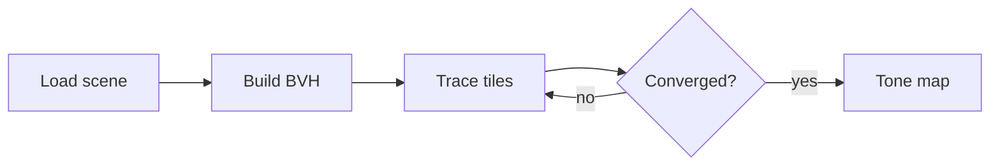

# Lumen: design notes

Lumen is a small path tracer written to learn how physically based renderers work. These notes
cover the frame pipeline, the geometry it supports, and where the time goes.

| Stage | Owner | Status |
| --- | --- | --- |
| Scene loading | `scene.rs` | Done |
| BVH construction | `bvh.rs` | Done |
| Shading | `material.rs` | In progress |
| Denoising | — | Planned |

- [x] Spheres, planes and triangle meshes
- [x] Bounding volume hierarchy
- [ ] Importance sampling for area lights

## Frame pipeline

Each frame is split into tiles, and every tile is traced independently on a worker thread.
Passes repeat until the image stops changing.



## Intersecting a sphere

A ray $\mathbf{r}(t) = \mathbf{o} + t\,\mathbf{d}$ hits a sphere of radius $r$ centred at
$\mathbf{c}$ wherever $\lVert \mathbf{r}(t) - \mathbf{c} \rVert^2 = r^2$. Expanding gives a
quadratic in $t$:

$$
t = \frac{-b \pm \sqrt{b^2 - 4ac}}{2a},
\qquad a = \mathbf{d}\cdot\mathbf{d},\;
b = 2\,\mathbf{d}\cdot(\mathbf{o}-\mathbf{c}),\;
c = \lVert \mathbf{o}-\mathbf{c} \rVert^2 - r^2
$$

The nearest positive root is the hit. In code:

```rust
pub fn hit(&self, ray: &Ray, t_min: f32, t_max: f32) -> Option<Hit> {
    let oc = ray.origin - self.center;
    let a = ray.dir.dot(ray.dir);
    let half_b = oc.dot(ray.dir);
    let c = oc.dot(oc) - self.radius * self.radius;

    let discriminant = half_b * half_b - a * c;
    if discriminant < 0.0 {
        return None;
    }

    let root = (-half_b - discriminant.sqrt()) / a;
    (t_min..t_max).contains(&root).then(|| Hit::new(ray, root, self))
}
```

## Shading

Lumen uses the rendering equation directly, estimated by Monte Carlo sampling:

$$
L_o(\mathbf{x}, \omega_o) = L_e(\mathbf{x}, \omega_o)
+ \int_{\Omega} f_r(\mathbf{x}, \omega_i, \omega_o)\, L_i(\mathbf{x}, \omega_i)\,
(\omega_i \cdot \mathbf{n})\, d\omega_i
$$

> **Note:** materials are evaluated in tangent space, so every BRDF can assume the surface
> normal is $+z$.

## Performance

Measured on the Cornell box scene at 1280×720, 64 samples per pixel:

| Change | Time per frame | Speed-up |
| --- | ---: | ---: |
| Baseline | 41.2 s | 1.0× |
| BVH (median split) | 6.8 s | 6.1× |
| BVH (SAH) | 4.9 s | 8.4× |
| Tiles on 8 threads | 0.7 s | 58.9× |

## Open questions

1. Is a wavefront design worth it before GPU support?
2. Should textures be loaded lazily, per tile?
